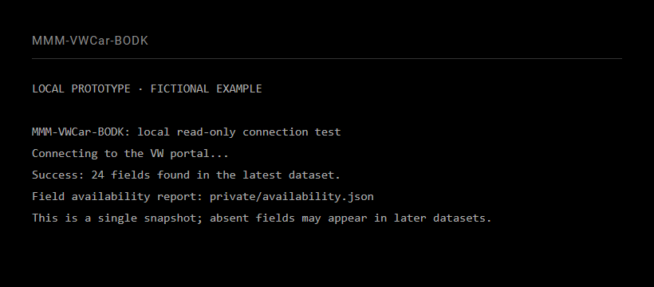

# MMM-VWCar-BODK

## Description

Local connection feasibility test for a future Volkswagen MagicMirror² module, initially targeting an ID.7 in Denmark. **This is not yet an installable MagicMirror² display module.** There is no module config to paste into MagicMirror² yet. The immediate goal is to establish account access and discover available fields before implementing the display.

The [community EU Data Act connector](https://github.com/mikrohard/CarConnectivity-connector-vw-eu-data-act) reports that VW blocked third-party WeConnect access. This test uses the alternative [VW EU Data Act portal](https://eu-data-act.drivesomethinggreater.com/). It provides partial, read-only batch data, roughly every 15 minutes. App data availability does not guarantee portal availability. GPS and estimated range may be missing. This is unofficial integration software; login and data formats may change.

### Preview

Illustrative terminal output for the local connection prototype, using fictional results. This is not a MagicMirror² display module or a real account test. English is the default language.



The [browser preview](docs/preview.html) uses fictional data only; it does not validate external services or hardware.

## Requirements

Requires Node.js 22+ (use a version supported by your MagicMirror² installation), Python 3.10+ with pip and venv, and HTTPS access to VW and PyPI. On Linux, Python/venv must be installed through your OS separately. npm does not install system packages.

## Installation

### Account preparation

1. Log into the VW EU Data Act portal using your Volkswagen ID.
2. Open **Data clusters → Vehicle overview** and connect your car if necessary.
3. Choose **Get customised data** and create a **continuous** request with a **15-minute** frequency.
4. Complete any required consent or MFA steps yourself in the browser.
5. Wait until the portal lists a ZIP dataset containing data.

The test does not create requests or accept terms for you. Browser login does not necessarily resolve automated-login MFA restrictions.

Clone this prototype on the device hosting MagicMirror², then install its dependencies:

```sh
cd ~/MagicMirror/modules
git clone https://github.com/BravoOscarDK/MMM-VWCar-BODK.git
cd MMM-VWCar-BODK
npm install
npm run probe
```

Installation creates `.venv` and installs the pinned Python integration. If Python is not on PATH, set `VWCAR_PYTHON` to its executable path before installation. Re-running setup preserves existing local files.

On this Windows workspace, the prepared environment can also be started directly:

```powershell
cd C:\Dev\MagicMirror\MMM-VWCar-BODK
.\.venv\Scripts\python.exe scripts/probe.py
```

Enter your email and hidden password in your own terminal, never in chat or command-line arguments. Credentials and session cookies remain in process memory and are not written to disk. If more than one vehicle is returned, select its number using the displayed VIN suffix.

The test fetches the newest dated dataset with content for one vehicle, then exits. Each network request has a 30-second timeout; the underlying client may retry some requests. Ctrl+C cancels. There is no background polling or vehicle control. On errors, raw upstream exception bodies are suppressed to avoid leaking account data.

## Configuration

This is a local feasibility test, not an installable MagicMirror² display module. There is no supported entry for `config/config.js` yet. Run `npm run probe` from the project directory and follow its terminal prompts.

### Result

On success, `private/availability.json` contains field names and whether a value was present, without VIN, account identifiers or field values. It overwrites the previous successful report; failures leave the previous report unchanged, so check `checkedAt`. A single dataset is only a snapshot: omitted fields may arrive later. The `private/` directory is excluded from Git.

## Language

All current terminal prompts and diagnostics are in English. A configurable display language is planned for the future module: English (`en`) by default and Danish (`da`) as an option. The current probe does not expose a MagicMirror² language config.

## Updating

Run these commands in the prototype directory:

```sh
cd ~/MagicMirror/modules/MMM-VWCar-BODK
git pull --ff-only
npm install
```

Run `npm run probe` manually when needed. There is no MagicMirror² display or background service to restart in this prototype.

## Troubleshooting

If a vehicle is listed, login and vehicle discovery succeeded. Data retrieval is a separate step. The probe now identifies failures at **continuous request metadata**, **dataset listing**, or **dataset download**, and shows an HTTP status when supplied by the client. It does not print upstream URLs, filenames or response bodies. A metadata HTTP 404 can indicate a missing continuous request or an endpoint change; it does not prove either cause. Confirm that the portal shows a continuous request (not just a one-off export) and lets you download a dataset. HTTP 401/403 indicates refused access; HTTP 5xx indicates a server error. Share the diagnostic lines to investigate further.

Check Python/venv availability, the portal consent and continuous data request, and whether a ZIP dataset is available. Raw upstream error bodies are suppressed to avoid leaking account data. A browser login may not resolve automated-login MFA restrictions.

## Validation

```sh
npm test
npm run check
```

Tests use mock data and verify file selection, missing requests, single-download behavior and removal of personal values from reports. They do not prove VW login, ID.7 access or Raspberry Pi compatibility. Dependencies were installed on Windows.

## License

MIT; see [LICENSE](LICENSE). The Python connector and CarConnectivity are external MIT-licensed dependencies.
